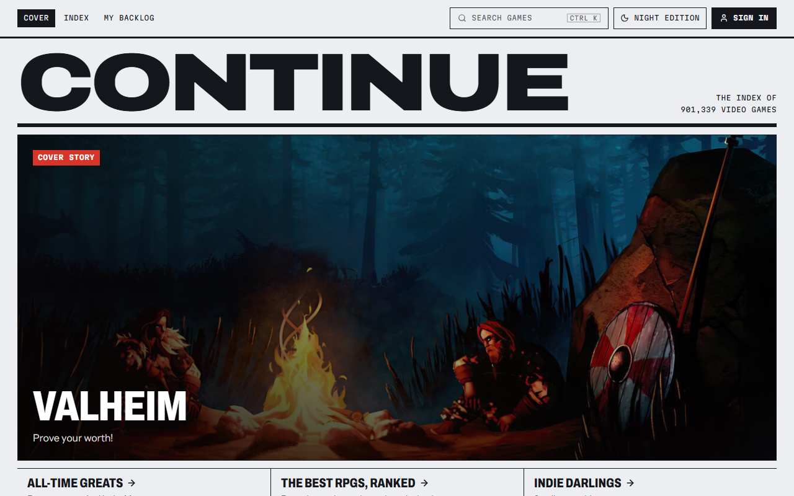
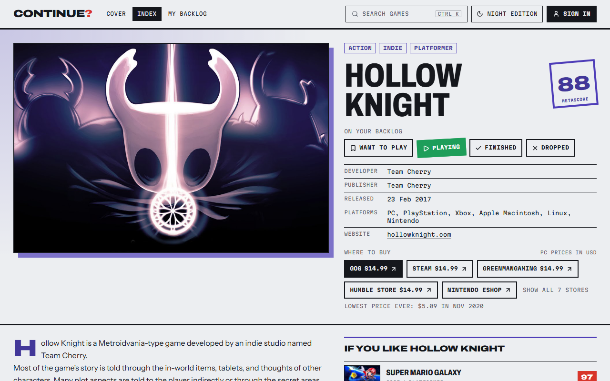
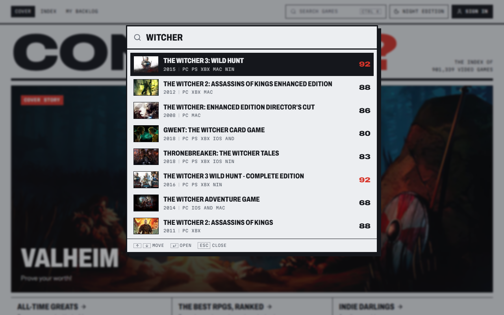
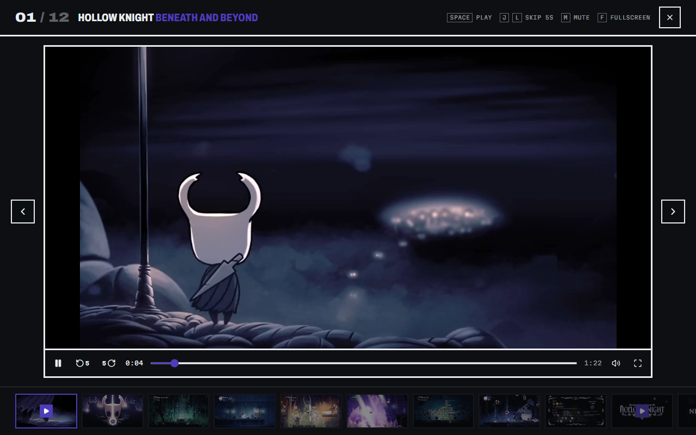
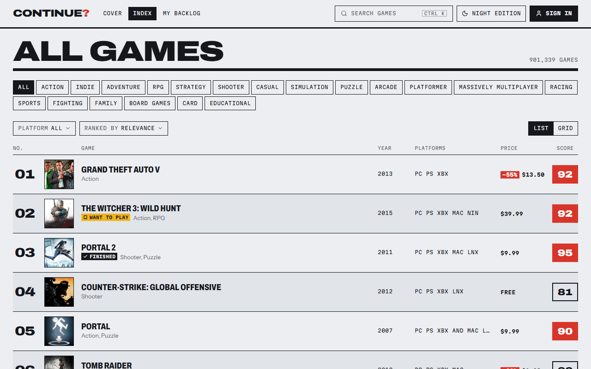
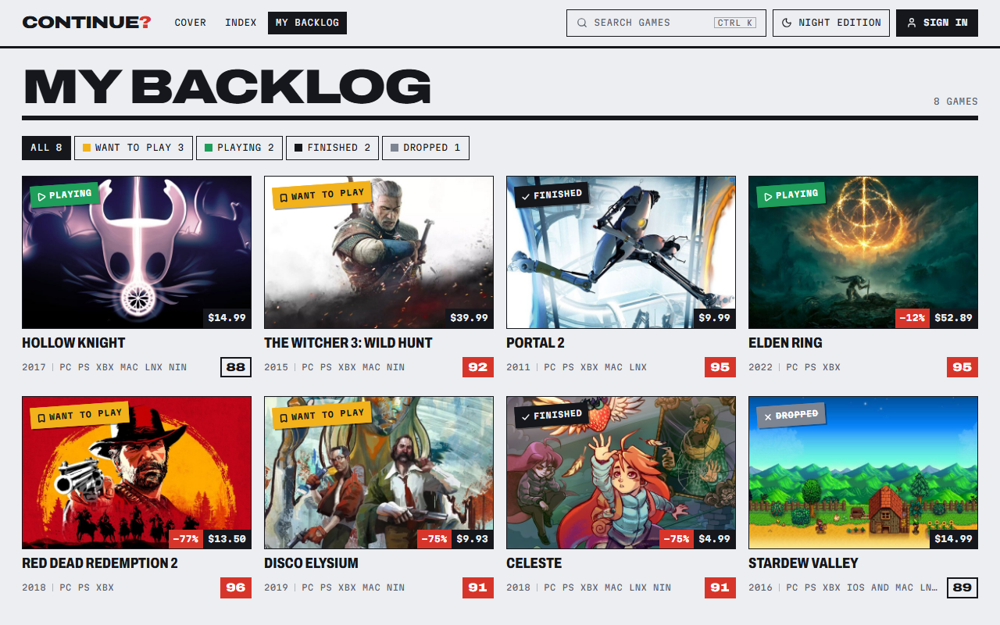

# Continue?

[](https://github.com/y3rsss/continue-gms/actions/workflows/ci.yml)
[](https://continue-gms.vercel.app)

The video game index. Browse over 900,000 games, compare scores and prices, and keep a backlog of what to play next.

**Live:** [continue-gms.vercel.app](https://continue-gms.vercel.app)



## Features

- **Cover page** with a trending cover story and rows of trending, new and all-time great games
- **Index** of every game as a ranked list or a grid, filtered by genre, platform and search. Filters live in the URL, so any view can be bookmarked or shared.
- **Instant search** with <kbd>Ctrl</kbd> <kbd>K</kbd> from anywhere. It forgives typos ("wither" finds The Witcher), understands initials ("gta", "cod") and ranks by how well the name matches and how popular the game is.
- **Game pages** printed in a spot color taken from the game's cover art, with details, similar games and a full-screen gallery of screenshots and trailers
- **Prices on every game**: the cheapest current PC price and its discount, on cards and in the index
- **Where to buy** with links to every store, PC prices, discounts, the best deal and the lowest price ever
- **Backlog** to stamp games as Want to play, Playing, Finished or Dropped and filter them by status. Works without an account.
- **Accounts** with Google, GitHub or email. The backlog syncs between devices, and games saved before signing in come along.
- **Public profiles**: a profile is private until you make it public, then anyone with the link can see your backlog
- **Link previews** that show the game's cover, score and best price when a link is shared in Telegram, Discord, Slack and other apps
- **Day and night editions** (light and dark mode)



| Instant search                           | Gallery and trailers                                |
| ---------------------------------------- | --------------------------------------------------- |
|        |  |
| **The index with prices**                | **A backlog**                                       |
|  |    |

## How it works

- **Own API.** The browser never calls RAWG or IsThereAnyDeal. It calls the app's `/api` routes, which keep the keys on the server, validate input, reshape responses into the app's own types and cache them on Vercel's CDN.
- **Prices** are stored in Postgres, where only the server can reach them. The server asks IsThereAnyDeal only about games that are new or were checked more than 12 hours ago, in one bulk request.
- **Accounts and backlogs** go from the browser straight to Supabase. Row level security decides who can read or change each row, so other people see a backlog only when its profile is public. Signed out, the backlog stays in the browser and moves to the account on sign-in.
- **Link previews.** Chat apps' bots don't run JavaScript, so they get a small server-rendered page with the game's cover, score and price.

## Tech stack

| Area          | Tools                                                                                                        |
| ------------- | ------------------------------------------------------------------------------------------------------------ |
| Frontend      | React 19, TypeScript, Vite 8, Tailwind CSS 4, shadcn/ui on Radix, TanStack Query, React Router 8             |
| Backend       | REST API on Vercel Functions (Node 24, TypeScript), Supabase Auth with Google, GitHub and email              |
| Database      | Postgres on Supabase, with row level security                                                                |
| External APIs | [RAWG](https://rawg.io/apidocs) for game data, [IsThereAnyDeal](https://docs.isthereanydeal.com/) for prices |
| Testing       | Vitest, Playwright, GitHub Actions                                                                           |
| Tooling       | ESLint, typescript-eslint, Prettier                                                                          |

## Running locally

You need Node 24 and a free RAWG API key from [rawg.io/apidocs](https://rawg.io/apidocs). Prices also need a free IsThereAnyDeal API key from [isthereanydeal.com/apps/my](https://isthereanydeal.com/apps/my/) and the Supabase project's secret key. Without them the app still runs, just without prices.

```bash
npm install
cp .env.example .env.local   # then fill in the keys
npm run dev
```

The dev server runs the `/api` routes too, and reloads them when you edit them, so local behaves like production.

The committed `.env` holds the live Supabase project's URL and publishable key, which are public by design. To run on your own project, create one, apply the migrations with `npx supabase link` and `npx supabase db push`, put its URL and publishable key in `.env` and its secret key in `.env.local`.

| Script                 | What it does                                    |
| ---------------------- | ----------------------------------------------- |
| `npm run dev`          | Start the dev server                            |
| `npm run build`        | Typecheck and build for production              |
| `npm run preview`      | Serve the production build locally              |
| `npm run lint`         | Lint the project                                |
| `npm run format`       | Format every file with Prettier                 |
| `npm run format:check` | Check the formatting without changing files     |
| `npm test`             | Run the unit tests                              |
| `npm run test:watch`   | Run the unit tests again on every save          |
| `npm run test:e2e`     | Build the app and run the browser tests         |
| `npm run db:types`     | Regenerate the database types after a migration |

## Testing

- **Unit tests** (Vitest) sit next to the code they test, as `*.test.ts`. They cover the search ranking, store prices and offers, link preview pages, input validation of every endpoint, and the formatting helpers. Calls to RAWG, IsThereAnyDeal and the database are faked, so the tests never touch the network.
- **End-to-end tests** (Playwright) live in [`e2e/`](e2e) and click through the real app in a browser: search, game pages, the gallery, the backlog, filters, dark mode and phone-sized screens. They answer `/api` requests with recorded responses from [`e2e/fixtures`](e2e/fixtures), so they run offline and don't need an API key.
- **CI** (GitHub Actions) runs the format check, lint, typecheck, unit tests, build and end-to-end tests on every push and pull request.

## Project structure

```text
api/            Vercel functions: games, game, genres, platforms, prices, stores, search, share
  _lib/         Shared server code: RAWG and IsThereAnyDeal clients, search, prices, offers
shared/         Types and helpers used by both the API and the app
src/
  pages/        Cover, index, game, backlog, profile, settings, privacy and error pages
  components/   UI components
  hooks/        Data fetching, URL filters, backlog, session and profile, keyboard shortcuts
  lib/          Supabase client, backlog sync, formatting, spot colors, status styles
supabase/       Database migrations, auth email templates and config
e2e/            Browser tests and recorded API responses
```

## Credits

Game data and images come from [RAWG](https://rawg.io). Prices come from [IsThereAnyDeal](https://isthereanydeal.com).
