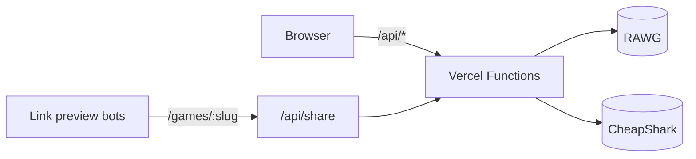

# Continue?

[](https://github.com/y3rsss/continue-gms/actions/workflows/ci.yml)
[](https://continue-gms.vercel.app)

The video game index. Browse over 900,000 games, compare scores and prices, and keep a backlog of what to play next.

**Live:** [continue-gms.vercel.app](https://continue-gms.vercel.app)


## Features

- **Cover page** with a trending cover story and rows of trending, new and all-time great games
- **Index** of every game as a ranked list or a grid, filtered by genre, platform and search. Filters live in the URL, so any view can be bookmarked or shared.
- **Instant search** with <kbd>Ctrl</kbd> <kbd>K</kbd> from anywhere. It forgives typos ("wither" finds The Witcher), understands initials ("gta", "cod") and ranks by how well the name matches and how popular the game is.
- **Game pages** printed in a spot color taken from the game's cover art, with details, similar games and a full-screen gallery of screenshots and trailers
- **Where to buy** with links to every store, live PC prices, discounts, the best deal and the lowest price ever
- **Backlog** to stamp games as Want to play, Playing, Finished or Dropped
- **Link previews** that show the game's cover, score and best price when a link is shared in Telegram, Discord, Slack and other apps
- **Day and night editions** (light and dark mode)


| Instant search                     | Gallery and trailers                                |
| ---------------------------------- | --------------------------------------------------- |
|  |  |

## How it works



The browser never talks to the game data providers directly. It calls the app's own `/api` routes, which:

- add the API key on the server, where nobody can read it
- validate input and answer bad requests with clear errors
- reshape every response into the app's own types, so switching data providers only touches the server
- cache responses on Vercel's CDN

Link preview bots (they don't run JavaScript) are routed to a small server-rendered page with the game's preview tags. Everyone else gets the normal app.

## Tech stack

| Area             | Tools                                                                                                          |
| ---------------- | -------------------------------------------------------------------------------------------------------------- |
| App              | React 19, TypeScript, Vite 8                                                                                   |
| Styling          | Tailwind CSS 4, shadcn/ui on Radix                                                                             |
| Data and routing | TanStack Query, React Router 8                                                                                 |
| API              | Vercel Functions in front of [RAWG](https://rawg.io/apidocs) and [CheapShark](https://apidocs.cheapshark.com/) |
| Testing          | Vitest, Playwright, GitHub Actions                                                                             |
| Tooling          | ESLint, typescript-eslint, Prettier                                                                            |

## Running locally

You need Node 24 and a free RAWG API key from [rawg.io/apidocs](https://rawg.io/apidocs).

```bash
npm install
cp .env.example .env.local   # then set RAWG_API_KEY
npm run dev
```

The dev server runs the `/api` routes too, and reloads them when you edit them, so local behaves like production.

| Script               | What it does                            |
| -------------------- | --------------------------------------- |
| `npm run dev`        | Start the dev server                    |
| `npm run build`      | Typecheck and build for production      |
| `npm run preview`    | Serve the production build locally      |
| `npm run lint`       | Lint the project                        |
| `npm run format`     | Format every file with Prettier         |
| `npm test`           | Run the unit tests                      |
| `npm run test:watch` | Run the unit tests again on every save  |
| `npm run test:e2e`   | Build the app and run the browser tests |

## Testing

- **Unit tests** (Vitest) sit next to the code they test, as `*.test.ts`. They cover the search ranking, store prices and offers, link preview pages, input validation of every endpoint, and the formatting helpers. Calls to RAWG and CheapShark are faked, so the tests never touch the network.
- **End-to-end tests** (Playwright) live in [`e2e/`](e2e) and click through the real app in a browser: search, game pages, the gallery, the backlog, filters, dark mode and phone-sized screens. They answer `/api` requests with recorded responses from [`e2e/fixtures`](e2e/fixtures), so they run offline and don't need an API key.
- **CI** (GitHub Actions) runs the format check, lint, typecheck, unit tests, build and end-to-end tests on every push and pull request.

## Project structure

```text
api/            Vercel functions: games, game, genres, platforms, stores, search, share
  _lib/         Shared server code: RAWG and CheapShark clients, search, offers
shared/         Types and helpers used by both the API and the app
src/
  pages/        Cover, index, game, backlog and error pages
  components/   UI components
  hooks/        Data fetching, URL filters, backlog, keyboard shortcuts
  lib/          Formatting, spot colors, status styles
e2e/            Browser tests and recorded API responses
```

## Credits

Game data and images come from [RAWG](https://rawg.io). Prices come from [CheapShark](https://www.cheapshark.com).
